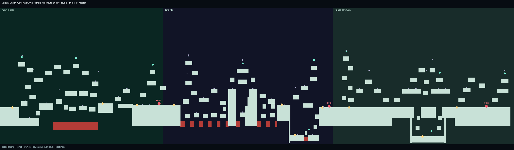

# Map & Background Design — "Verdant Chasm"

The world is three biomes authored as separate rooms (in
`app/src/main/java/com/devdgames/hollowknightbutmine/game/env/`) but played
as one continuous 13,900px map stitched together by `GameWorld`
(`mossy_bridge` @ 0, `dark_ribs` @ 4400, `ruined_sanctuary` @ 9000).

*White = reachable with single jumps · gold ◆ = bench · cyan ● = soul cache · red = hazard.
Regenerate with `python3 tools/verify_map.py --render map_preview.png`.*

## Jump metrics every layout obeys

From `Player` (run 260 px/s, jump −540, gravity 1250):

| | value |
| --- | --- |
| Single-jump apex | ≈ 117 px |
| Comfortable step-up | ≤ 90 px rise |
| Flat gap (same height) | ≤ ~190 px |
| Main route | **single jumps only** — double-jump/dash is never required |
| Optional routes | soul caches and shortcuts may ask a little more |

`tools/verify_map.py` parses the Kotlin layouts, rebuilds the world the
same way the game does, and proves with a flight-time model (15% safety
margin) that the spawn reaches every bench, every boss and the far end —
and can walk back. Run it after touching any room layout.

## Biome 1 — Moss Grotto: The Sunken Bridge

- **Verdant Shore** — terraces over a now-safe riverbed (falling early no
  longer means a void drop); a canopy climb loops back over the spawn
  shore to a soul cache. Landmark: the falls pouring into the lake.
- **The Sunken Bridge** — the grand bridge is broken into three cut-stone
  spans. Underneath, stepping-stone islets form a low route and catch
  falls; far above, a five-ledge canopy route skips the bridge fight and
  holds a cache. Landmark: mushroom tree over the far-shore bench.
- **Carapace Shrine** — terrace ascent **and** a low causeway (so you can
  also walk back), shrine plaza with bench before the Broodmother, roof
  sanctum + crown cache, stone gate arch marking the seam east.

## Biome 2 — Ossuary Depths: The Fossil Chasm

- **Bone Caverns** — spine-step zigzag to a high loft (cache). A chain of
  bone rafts now runs the length of spike trench 1 as a low/recovery
  route — falling off the spine is a detour, not a biome restart.
- **Rib Citadel** — two fossil towers + bridge, a crown beam above the
  bridge (cache), and buttress stairs so every trench can be climbed out.
- **Catacomb Vaults** — high vault ledges (crown cache) and, beneath them,
  a sunken **crypt** with its own bench and a guarded cache. Landmark:
  the colossal skull in the backdrop, eyes breathing soul-light.

## Biome 3 — The Overgrown Colonnade

- **Outer Portico** — courtyard terraces plus a **bell tower** spiralling
  up the west wall (belfry cache). Landmark: broken statue, head fallen.
- **Grand Balconies** — two-story balconies, chandelier ledges and a high
  traverse; below, the once-endless flat floor is broken by two shafts
  into a candle-lit **crypt** (bench + cache) running under the colonnade.
- **Throne Sanctum** — audience galleries, a hanging ledge over the arena,
  braziers, royal box with its own stair and crown cache, throne beneath
  the rose window.

## World systems added with the map

- **Benches (10)** — touch to rest: masks restored, death respawn moves
  there. Lit benches burn gold on the map chart.
- **Soul caches (11)** — hovering vessels on high/secret routes, +33 Soul.
- **Hazard respawn** — spikes/water return you to the last solid ground
  you stood on, not to the biome entrance.
- **Seam gates & flush floors** — biome joins are level (460/480) and
  marked with architecture, so crossings read as places, not teleports.
- **Area title cards** — serif biome title + subtitle fades in on entry.
- **World chart** — `M` / `Tab` / on-screen **Map** button pauses the game
  and shows the whole connected map generated from the real geometry:
  visited biomes in detail, unvisited left blank, with you / benches /
  caches / bosses / hazards marked.

## Background (parallax) system

Previously all three rooms' backdrops were painted stacked on top of each
other everywhere. Now:

- `GameWorld` paints one **biome-blended sky** per frame; gradients and
  fog colour cross-fade over ±460 px around each seam.
- Each biome's backdrop is drawn with its **own local camera** and
  **clipped to its own stretch of screen**, so scenes meet at the seams
  instead of overlapping.
- Three depth layers per biome (0.12 / 0.30 / 0.55 parallax), authored in
  full room coordinates and horizontally compressed by `Room.beginLayer`
  so the entire backdrop is traversed as you cross the room — landmarks
  (waterfall mist, skull, rose window, shrine dome…) stay anchored behind
  the places they belong to, on any screen width.
- Drifting **fog banks + ground haze** between backdrop and world;
  out-of-focus **foreground** roots/pillars sweep past at 1.22×;
  one unified radial **vignette** replaces the old per-room edge bars.

## Ground rendering (`Slab`)

Platforms are no longer filled rectangles:

- `ROCK` — sagging underside with stalactite teeth, cracks, strata lines,
  embedded pebbles.
- `BONE` — segmented bands and marrow pits (ossuary platforms/towers).
- `CUT_STONE` — masonry block joints and corbelled undersides (bridge,
  sanctuary). Moss, swaying grass and glow mushrooms still grow on top.
- All geometry is pre-built once with a seeded RNG; off-screen slabs,
  rooms, enemies and decorations are culled against the visible rect.
